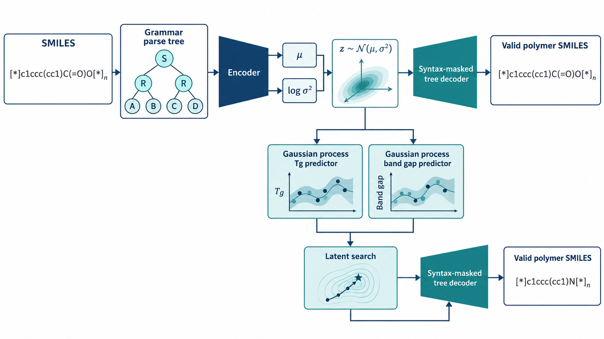
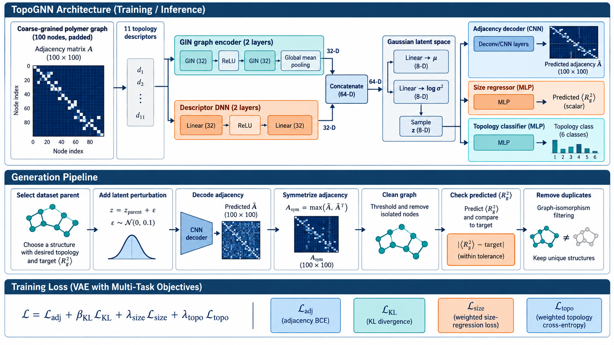
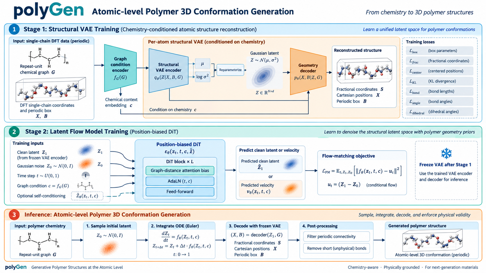
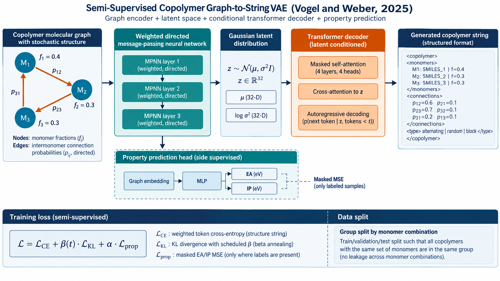
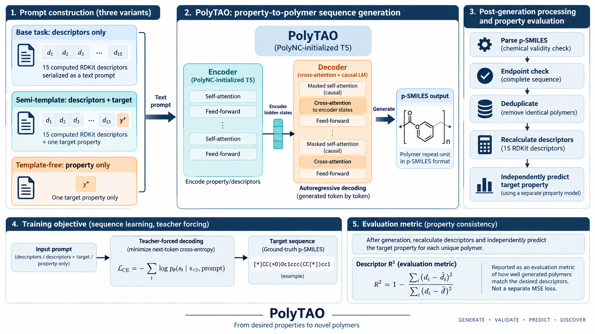
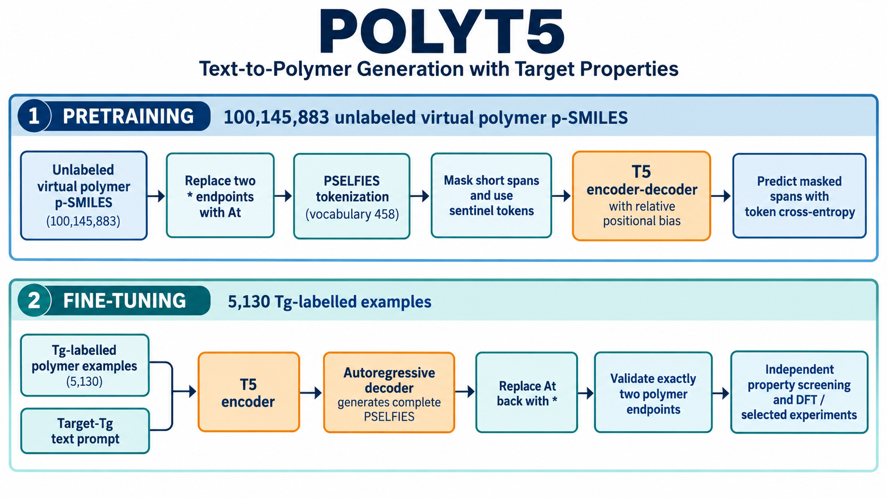

# PolymerGenerativeModel

聚合物生成模型的可视化阅读与复现笔记。这里把论文中的**生成对象、数据、模型、训练目标和采样流程**整理成逐篇指南，并配有直接生成的架构示意图，方便快速比较方法、再进入细节。

> 图为帮助理解数据流的原创示意图，不是论文原图。实验数值、方法细节和适用边界请以各论文、补充信息与作者代码为准。项目内容是文献整理，不代表已复跑论文实验。

## 从这里开始

- [综述导读：Polymer Genome 进入 AI 时代](research_output/公众号_聚合物基因组进入AI时代.md)
- [模型笔记索引与复现说明](#模型图鉴)
- [复现边界与引用](#复现边界与引用)

## 模型图鉴

### 聚合物结构与拓扑生成

| SD-VAE · 语法约束潜空间 | TopoGNN · 拓扑图 VAE |
|:--:|:--:|
|  |  |
| [打开复现笔记 →](research_output/notes/01_SDVAE_2020.md) | [打开复现笔记 →](research_output/notes/02_TopoGNN_2024.md) |

| polyGen · 原子级周期链构象 | polyG2G · 图到图逆向设计 |
|:--:|:--:|
|  |  |
| [打开复现笔记 →](research_output/notes/03_polyGen_2025.md) | [打开复现笔记 →](research_output/notes/08_PolyG2G_2021.md) |

### 共聚物与电解质设计

| Graph-to-String VAE · 共聚物组成和链架构 | minGPT · 电解质序列生成 |
|:--:|:--:|
|  |  |
| [打开复现笔记 →](research_output/notes/04_Copolymer_Graph2String_2025.md) | [打开复现笔记 →](research_output/notes/05_Electrolyte_GPT_Diffusion_2024.md) |

| 1Ddiffusion · token 扩散 | Diffusion-LM · 连续嵌入扩散 |
|:--:|:--:|
|  |  |
| [打开三种电解质生成模型的复现笔记 →](research_output/notes/05_Electrolyte_GPT_Diffusion_2024.md) | [打开三种电解质生成模型的复现笔记 →](research_output/notes/05_Electrolyte_GPT_Diffusion_2024.md) |

### 条件生成与预训练模型

| PolyTAO · 描述符条件生成 | POLYT5 · PSELFIES 条件生成 |
|:--:|:--:|
|  |  |
| [打开复现笔记 →](research_output/notes/06_PolyTAO_2024.md) | [打开复现笔记 →](research_output/notes/07_POLYT5_2026.md) |

### 生成模型基准：六种架构

| VAE | AAE | ORGAN |
|:--:|:--:|:--:|
|  |  |  |

| CharRNN | REINVENT | GraphINVENT |
|:--:|:--:|:--:|
|  |  |  |

六种基准模型的数据拆分、优化目标、奖励与评价设置见[基准复现笔记](research_output/notes/09_Generative_Benchmark_2025.md)。

## 复现边界与引用

每篇笔记尽量明确了数据来源与标签、结构表示、模型组成、损失函数/训练目标、条件方式、采样与筛选流程，并标出版本差异和缺失项。公开笔记链接到出版社、预印本、作者代码或数据页面；本仓库聚焦于图与说明，不重新分发原论文 PDF、补充材料或完整数据集。若论文未公开训练集、权重或关键参数，笔记会注明，不能据此声称已完整复现。

如使用本项目，请引用对应原论文；图为本项目原创的生成式架构示意图，请同时注明本仓库。综述总结见[公众号版 Markdown](research_output/公众号_聚合物基因组进入AI时代.md)。
