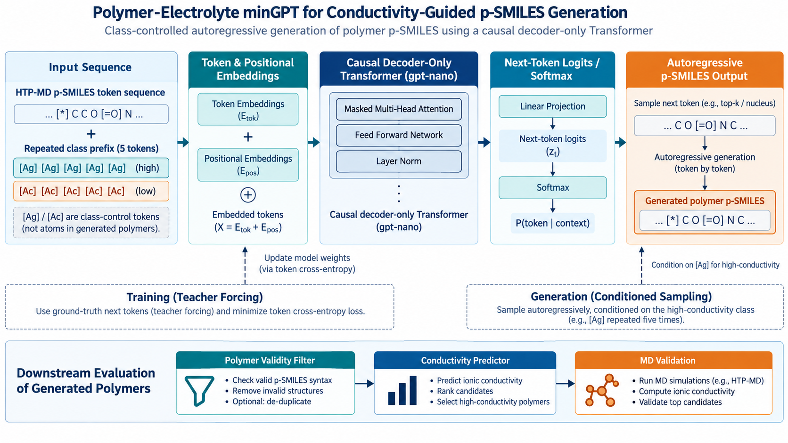
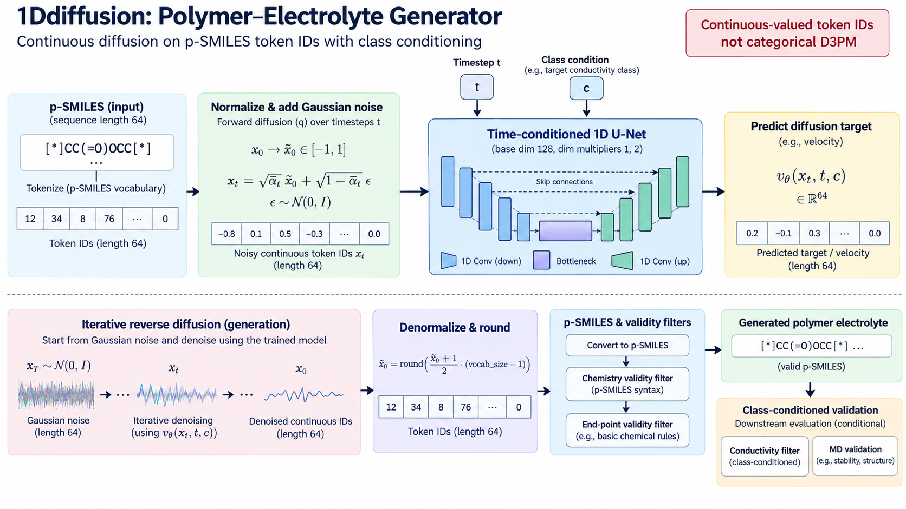
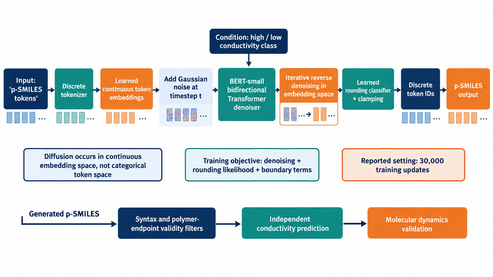

# 电解质逆向设计：minGPT、1Ddiffusion 与 Diffusion-LM

**论文**：Yang et al., *De novo design of polymer electrolytes using GPT-based and diffusion-based generative models*, npj Computational Materials 10, 296 (2024)，[DOI](https://doi.org/10.1038/s41524-024-01470-9)。综述 [68]。

[原文与补充信息](https://doi.org/10.1038/s41524-024-01470-9)；[代码](https://github.com/TRI-AMDD/PolyGen)。注意此仓库 PolyGen 和 Jain 的三维 polyGen 是不同工作。





## 数据定义：先固定温度、盐和力场

HTP-MD 子集包含 6024 个线形均聚物重复单元，元素 C/H/O/N/S/P/F；标签来自 MD。随机 80/20 训练测试。p-SMILES 两个星号表示链端，DeepChem tokenization，长度补齐为 64，基础任务共 20 个 token（含特殊符号）。PI1M 预训练时两库统一采用 DeepChem 字符列表，不能继续沿用小数据的 20-token 词表。[Methods]

条件是高/低电导二分类，使用数据中未出现的 [Ag]、[Ac] 作为标签 token。minGPT 在前缀重复标签五次，扩散方案使用一个。**这些符号是控制标记，不表示在聚合物中加入银或锕。** 分组阈值应读取作者数据处理配置并保存；未核实前不能随意使用中位数或 1e-4 S/cm。

作者 CSV 两列 mol_smiles、conductivity，后者为 1/0 分类，文件实际以 tab 分隔；Diffusion-LM 使用 JSON。连续 σ 与训练条件列应分开保存。[作者 README]

## 三个模型的实质差别

| 模型 | 训练数据空间 | 网络 | 从输出恢复 token |
|---|---|---|---|
| minGPT | 离散 token 序列 | 因果 Decoder Transformer | softmax 采样下一个 token |
| 1Ddiffusion | **token ID 的连续数值表示** | 1D U-Net | 数值取整回 token ID |
| Diffusion-LM | 可学习 token embedding | 时间条件双向 Transformer | 学习的 rounding / token classifier |

综述把第一种扩散表述为“离散 token 上加噪”。原方法实际上对 token ID 的连续表示添加高斯噪声，再取整；它不是 D3PM 那样的离散转移矩阵。词表索引顺序会改变这种连续几何，必须冻结 vocabulary。[Methods: Model architectures]

## 损失函数

minGPT 用 next-token CE：

$$L_{GPT}=-\sum_{t\in valid}\log p_\theta(s_t|s_{<t},c).$$

先移位输入/标签，PAD 不计损失。条件 token 是否也计入训练损失由 pipeline 的实现决定；复现要保持原规则。

1Ddiffusion 的基本 DDPM 定义为

$$x_t=\sqrt{\bar\alpha_t}x_0+\sqrt{1-\bar\alpha_t}\epsilon,$$
$$L_{noise}=E_{t,x_0,\epsilon}\|\epsilon-\epsilon_\theta(x_t,t,c)\|^2.$$

这给出噪声预测形式；具体作者使用 predict_noise/predict_x0、L1/L2、schedule 和归一化方式，应以 pipeline 与 U-Net 所绑定的 diffusion 类配置为准。不要只沿用上式就忽略 objective。

Diffusion-LM 在 embedding 空间扩散，涉及去噪回归、学习 embedding 和 rounding 的 token NLL，以及初末边界项。可概括为 L=Σt Lt,denoise + Lround + Lboundary；这是结构化说明，并非宣称每个作者实现的权重都为 1。它采用原 Diffusion-LM 的 loss reparameterization、clamping；应阅读 improved_diffusion/gaussian_diffusion.py 的 training_losses 分支，不能用纯噪声 MSE 替代。[Methods]

## 论文最优设置与代码默认值

| 模型 | SI Table 3 报告最优 | 参数量近似 |
|---|---|---|
| minGPT | gpt-nano；6000 training steps；temperature=1.0 | 0.12M |
| 1Ddiffusion | dim=128；dim_mults=(1,2)；80000 steps | 6M |
| Diffusion-LM | bert-small；in_channel=16；30000 steps | 14M |

这里 steps 是优化更新步数，不是对全数据遍历的 epochs；SI 网格表个别列标题写 epoch，执行以代码 max_iters 为准。预训练和微调实验也不能把这些配置直接当成同一任务的最优。

作者 README 注释记录 minGPT 默认 batch=64、lr=5e-4、Adam betas=(0.9,0.95)、weight_decay=0.1、grad_clip=1.0；这些是代码默认值。gpt-nano 架构须读取模型 preset，不使用完整 GPT-2 参数规模。GPT 的各 Transformer 层通常独立；正文关于“所有层参数共享”的一句不应直接变成实现要求，仓库说明 minGPT 原实现未改动。

## 生成与评估流程

先训练无条件模型，网格搜索每组生成 200 个候选；最终比较生成 1000 个。性能包括 validity、novelty、uniqueness、SA<5 比例、Tanimoto similarity、diversity。similarity 是生成集与训练集的成对均值；不是每个生成样本找最近邻的 SNN。[Methods: Evaluation protocol]

条件生成后用原 HTP-MD GNN 预测器筛选大量候选，再做 MD。PI1M 更宽的结构空间不一定处于该预测器适用域，因此不能把 PI1M 任意生成结果的 σ 排名直接当作可信结果。

## MD 验证足以影响结论的设置

353 K，约 1.5 mol/kg LiTFSI，50 Li+ 与 50 TFSI−；链主干至少约 150 heavy atoms，甲基封端。PCFF+，离子电荷缩放 0.7；初始无定形结构约 0.6 g/cm³；约 5 ns 退火/压缩平衡，再 5 ns NVT 生产。rRESPA 外步 2 fs、内步 0.5 fs，Nosé–Hoover 温控时间 200 fs。[SI 第 2–4 页]

使用 cluster Nernst–Einstein 的 cNE0 近似；簇判定距离 3.25 Å。连续电导 σ 的单位为 S/cm；取 log10 前先确认单位，S/m 转 S/cm 需除以 100。[SI 式 2]

46 个候选进一步模拟，17 个超过训练集最高 σ=5.07e-4 S/cm；最佳示例约 1.13e-3 S/cm。这是固定模拟条件下的结果，不是室温实测值。某些轨迹因构象不稳定或磷基团缺少力场参数失败；应保留失败计数。5 ns 生产对于慢扩散体系可能不足。[正文 Conditional generation]

## 操作路线

```bash
git clone https://github.com/TRI-AMDD/PolyGen.git
cd PolyGen
# 为 minGPT / diffusion1D / diffusionLM 分别使用 README 对应环境
# 打开 minGPT_pipeline.ipynb 或 diffusion1D_pipeline.ipynb
# 依次执行 data_config -> model_config -> train_config -> generate_config
# diffusionLM_pipeline.ipynb 会写出实际 shell 脚本，再运行：
cd diffusionLM/improved-diffusion
bash train_conditional.sh
bash generate_conditional.sh
```

不能直接把三个 notebook 搬进同一个最新版 Transformers 环境：Diffusion-LM 包含修改版依赖。先验证 10 条 round-trip 与 EOS 截断，再进行论文设置训练。保存 tokenizer、条件阈值、数据划分、diffusion schedule、sampling steps、模型哈希和所有有效性过滤的分母。

**来源与缺口**：Methods、SI Tables 1–6、作者 README 和三个 pipeline。HTP-MD 数据入口为 [HTP-MD](https://www.htpmd.matr.io)，原轨迹分析代码 [htp_md](https://github.com/TRI-AMDD/htp_md)。本包未下载商业力场/建模软件，未执行训练和 MD。
