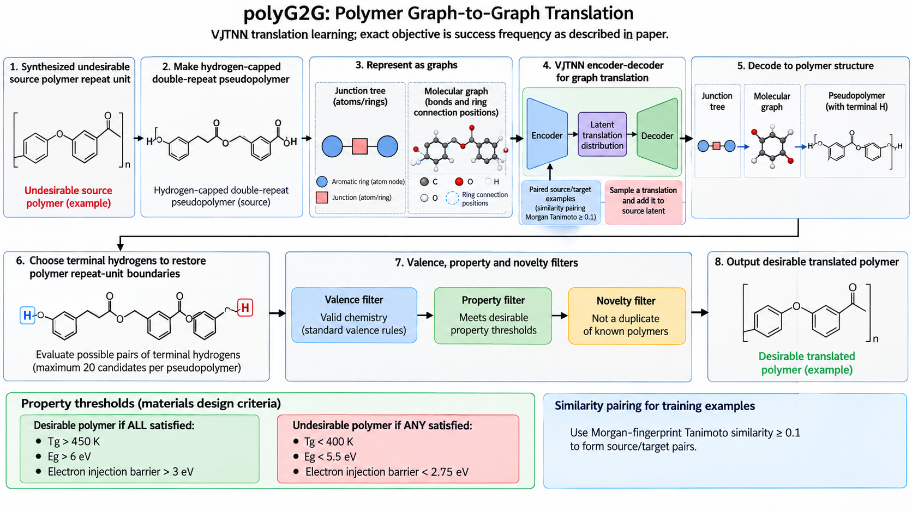

# polyG2G：用图到图翻译寻找高性能聚合物介电材料

**论文**：Gurnani et al., “polyG2G: A Novel Machine Learning Algorithm Applied to the Generative Design of Polymer Dielectrics,” *Chemistry of Materials* 33(17), 7008–7016 (2021), [DOI](https://doi.org/10.1021/acs.chemmater.1c02061)。综述参考文献 [66]。

**原文**：[ACS 文章页面与 DOI](https://doi.org/10.1021/acs.chemmater.1c02061)。论文 PDF 和作者公开补充材料可从文章页获取；没有找到该方法的公开训练代码仓库，故本笔记提供的是可操作的算法复现规范，不声称能直接复跑作者模型。架构图为直接生成的概念图，具体边界和阈值以论文为准。

## 生成目标

polyG2G 不是从随机噪声直接生成任意聚合物，而是从一个已知的低性能模板出发，学习“相似结构之间怎样改变化学连接可提升性能”，再把这种潜空间翻译应用到未见过的模板。论文对象是线性均聚物与交替共聚物，不覆盖支化/网络聚合物或一般无规共聚物。

设计对象是同时满足三项代理指标的材料：玻璃化转变温度 Tg、带隙 Eg、相对铝界面的电子注入势垒 φe。它们是击穿强度的代理量；模型并不直接预测或优化真实击穿实验。

## 数据、性质和结构表示

- 母数据包含 13,014 个已合成聚合物。Tg 取自聚合物手册；Eg 与电子注入势垒来自 DFT 数据。
- 为所有候选补齐性质时，作者使用 Gaussian process regression (GPR)，核函数为 RBF。Tg、Eg 与 φe 分别有性质预测器。母数据的性质预测与实验/DFT标签应分开存储，不能将 GPR 补全值标作实测值。
- 每个重复单元先转换为“双重复单元、两端由氢封端”的 pseudopolymer；生成后再选择端氢对恢复聚合物重复边界。
- 化学表示同时包含 junction tree（一次表示原子/环片段）和分子图（表示连接及环上连接位置）。前者避免逐原子生成时难以闭环，后者负责明确化学键。
- 配对相似度采用 Morgan 指纹 Tanimoto，相似阈值 t=0.1。

## 如何构造训练对

“desirable” 要求三项**全部**满足：Tg > 450 K、Eg > 6 eV、φe > 3 eV。“undesirable” 若三项中**任一项**满足 Tg < 400 K、Eg < 5.5 eV 或 φe < 2.75 eV 即归入该类。源集合 X 是 undesirable polymers；目标集合 Y 是 desirable polymers。

在 X 与 Y 之间枚举满足 Morgan-Tanimoto ≥ 0.1 的源/目标配对。一个源可配多个目标，一个目标也可配多个源，因此这是多对多翻译学习，不应把数据误写成每个源仅有唯一标签。

## 模型与损失

论文以 Variational Junction Tree Encoder-Decoder (VJTNN) 学习结构翻译的潜变量分布。将源 pseudopolymer 表示为 junction tree 与 graph，两路表示嵌入后拼接，再经 VJTNN 映射为翻译分布；从分布中采样若干潜空间翻译向量，加到源结构潜向量上，之后按 junction tree → graph → pseudopolymer 解码。

论文对训练目标的文字定义是：输入源结构，解码出与源足够相似、同时属于目标集合 Y 的 pseudopolymer；loss 按达到这一目标的频率计算。原文没有在正文中给出一条可直接照抄的完整公式，也没有公开可确认的 PolyG2G 训练代码。因此不应仅凭标准 VJTNN 给它杜撰重构项、KL 项或翻译项的权重。精确优化设置需要同时查作者 ESI 中的参数搜索内容；本工作目录当前保存的是正文 PDF，未保存该 ESI PDF。

## 生成与筛选

对训练集之外的低性能模板重复编码与潜空间翻译。每个翻译 pseudopolymer 最多抽取 `n_pair=20` 对端氢以恢复候选重复单元。候选需通过：

1. 所有原子满足价态；
2. GPR 预测满足设计性能门槛；
3. 在 PG 指纹空间相对于母数据和此前候选均不重复。

候选排序使用预测性能、结构独特性以及主链原子占比等因素构造的 fitness；在本地论文文字抽取中该公式的排版受损，精确复现应回看 PDF 正文式 (2)，不要从本笔记转录一个未经核对的公式。最高排名的 20 个候选进一步用 DFT 检验 Eg 与 φe。

## 论文报告的量级与解释

21 个训练模型共翻译出 58,023 个 pseudopolymers，其中 53,775 个通过化学有效性过滤（93%）。这些有效 pseudopolymers 扩展出 784,631 个有效重复单元，最终 3,556 个唯一候选通过多性质目标筛选，占总生成重复单元约 0.45%；母数据中符合目标者为 8/13,014。20 个候选接受 DFT 检验，其中 10 个通过带隙与注入势垒目标。Tg 对新材料仍是机器学习估计，尚需实验验证。

## 复现清单与限制

要做方法级复现，至少固定：母数据的 13,014 个身份和来源、实验/DFT/GPR 各性质标签、pseudopolymer 与两种图表示、Morgan 指纹版本与阈值、source/target 分类阈值、GPR 核及拟合流程、VJTNN checkpoint/训练配置、随机种子、`n_pair=20`、有效性和去重定义，以及 DFT 的结构和计算参数。建议按阶段记录：源/目标配对数、VJTNN 成功翻译率、有效 pseudopolymer 率、有效重复单元数、novelty、目标命中率、DFT 通过率。

关键限制：模型只能组合训练数据中已见的环片段；目标性质依赖代理模型；目标候选的“高性能”不是实验结果；翻译范围本身仍受线性链/指定共聚方式限制。

**证据定位**：正文图 1–2、Methods 2.1–2.6、Results 3.1–3.3；补充材料含模型参数优化细节。论文与补充信息请见 ACS 文章页。
