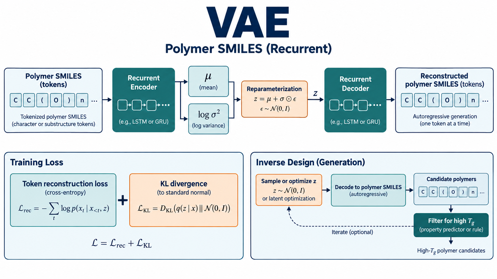
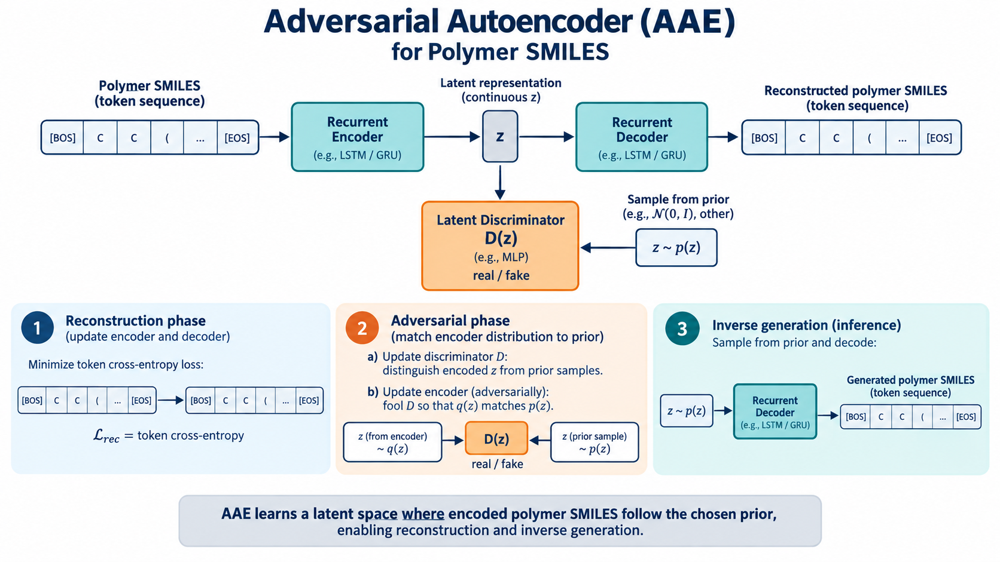
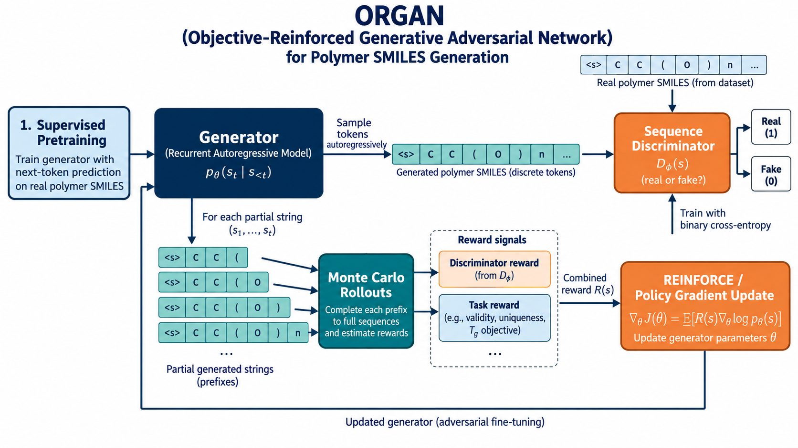
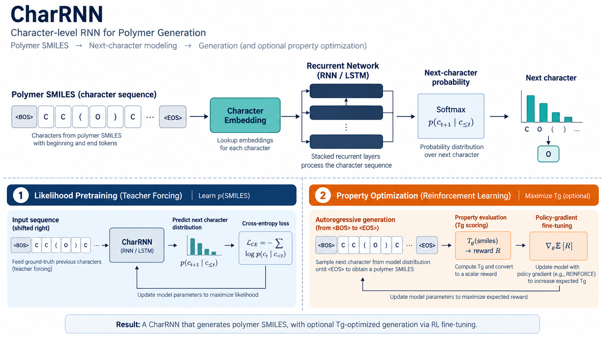
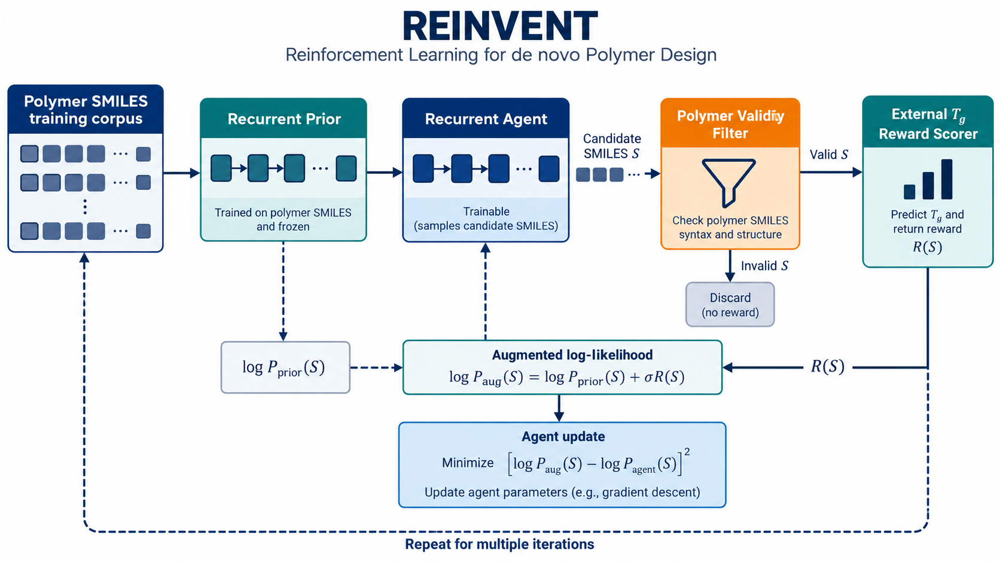
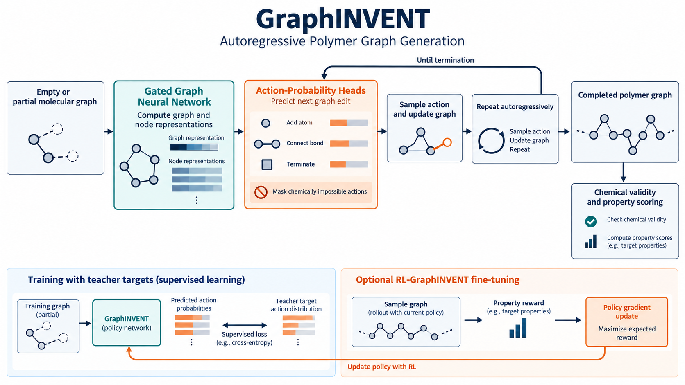

# 聚合物生成模型基准：六类模型的数据、目标与训练方式

**论文**：Yue et al., “Benchmarking study of deep generative models for inverse polymer design,” *Digital Discovery* 4, 910–926 (2025)，[DOI](https://doi.org/10.1039/D4DD00395K)。综述参考文献 [60]。

> 这六张图是按各模型家族和本文训练流程直接生成的架构示意图。图中省略了论文各数据集之间的细节差异；若某条结构/损失设置只由模型家族定义而非该篇 SI 明确指定，以下会标明需要查配置。

## 论文比较了什么

论文在三个数据领域比较 VAE、AAE、ORGAN、CharRNN、REINVENT 和 GraphINVENT：真实聚合物、以及分别从 PubChem 与 GDB-13 路线得到的假想聚酰亚胺。作者报告 CharRNN、REINVENT、GraphINVENT 在 PolyInfo 真实聚合物上表现突出；VAE、AAE 在假想结构上有优势。随后将 CharRNN、REINVENT 和 GraphINVENT 接入强化学习，在 PolyInfo 上以提高 Tg 为目标继续训练。

这是一项生成基准，不提供一个统一的“最优架构”。模型类型、训练语料、表示方式和性质奖励共同影响结果；三个数据集上的有效率不能脱离分母和去重口径横向比较。

## 数据与划分

- **真实聚合物**：作者从 PolyInfo 选择约 11,000 个均聚物用于训练、约 1,200 个用于测试。作者仓库中的 MOSES `train_polymer.py` 直接读取 `PolyInfo_train.csv` 和 `PolyInfo_test.csv`。
- **假想聚酰亚胺**：两条构库路线分别基于 PubChem 与 GDB-13；论文报告每个数据集选取 0.8 million 作为训练，另有两组各 0.2 million 的验证集。训练时不要把这些假想结构当成真实已合成材料。
- **属性标签**：强化学习阶段使用高 Tg 目标。若目标分数来自预测模型，它是优化信号而非新结构的实测 Tg。
- **评估**：包括有效结构比例、10,000 个样本的唯一率、SNN、internal diversity 和 FCD；还比较 Tg 分布。对聚合物必须把端点和表示规则一致纳入 validity 检查。

公开资料：论文标为开放获取，RSC 页面列有 SI；作者仓库和 Zenodo 提供代码、生成结果及假想聚酰亚胺数据。本次整理未能从 RSC 获取论文 PDF 与 SI（请求返回 403），因此 SI 的逐项参数表仍需下载核对。应把 SI 的逐项参数表视为待下载核对项。

## 六个模型的训练对象和目标

| 模型 | 表示与生成机制 | 核心训练目标 | 逆向设计方式 |
|---|---|---|---|
| VAE | SMILES token 序列；序列编码器得到高斯潜变量，RNN 解码 | token 重构负对数似然 + `KL(q(z|x) || N(0,I))` | 从先验采样或潜空间搜索后解码、过滤 |
| AAE | SMILES 序列编码到连续潜变量；判别器区分编码潜变量与先验样本 | 重构交叉熵 + 潜变量判别器/编码器的对抗先验匹配；不是 VAE KL | 从匹配的潜变量先验采样再解码 |
| ORGAN | 离散 SMILES 自回归生成器 + 序列真伪判别器 | 监督 next-token 预训练；对抗阶段的判别器 BCE 与 rollout 估计奖励后的策略梯度 | 以化学有效性/唯一性等目标优化；Tg-RL 为单独的后续设置 |
| CharRNN | 字符级自回归 RNN | next-character 交叉熵；Tg 优化阶段再以策略梯度最大化期望奖励 | 逐字符采样；强化学习阶段以 Tg scorer 引导 |
| REINVENT | 预训练 prior 与可训练 agent 均为序列生成器 | `[(log P_prior + σR) − log P_agent]^2` 的 augmented likelihood 目标 | Agent 采样、外部性质打分、更新 Agent |
| GraphINVENT | 逐步构图；GNN 预测原子添加、键连接、停止等动作分布 | teacher action-probability target 的监督损失；RL 版本用性质奖励更新策略 | 从空/部分图迭代采样图编辑动作 |

公式表达为模型家族的常见目标；具体掩码、缩放、权重、优化器与版本，以论文 SI 及其冻结仓库 commit 为准。尤其 ORGAN 不可通过离散 token 直接对生成器普通反传；GraphINVENT 不是 SMILES 解码器；REINVENT 不是简单“只最大化性质回归”。

## 复现配置与资源

论文的 PolyInfo 训练脚本和模型权重说明见作者 [GitHub 仓库](https://github.com/ytl0410/Polymer-Generative-Models-Benchmark)。仓库 README 指向固定版本的 MOSES、REINVENT 与 GraphINVENT；其 `GI_train.py` 给出 GraphINVENT-GGNN 的一个 PolyInfo 配置示例（`max_n_nodes=166`、400 epochs、batch size 100、初始学习率 1e-4），但这只是该脚本当前示例，不能替代 SI 表中每个数据集/模型的最终参数。GraphINVENT 与 RL 训练数据可通过仓库指向的 Zenodo 记录获取；PubChem/GDB-13 假想聚酰亚胺数据链接为 [Zenodo 13821449](https://zenodo.org/records/13821449)。

建议实际复现按以下顺序推进：

1. 获取三个数据集及原作者 split；保存 canonicalization、端点约束、tokenizer、词表和去重版本。
2. 固定各模型仓库 commit、Python/CUDA 版本与训练配置；先训练 likelihood 或 VAE/AAE 基线。
3. 逐类做 10,000 样本生成，统一 validity、uniqueness、SNN、IntDiv、FCD 的过滤和计算代码。
4. 只在 PolyInfo 的 RL 任务中复现 CharRNN、REINVENT、GraphINVENT；记录 Tg scorer、reward normalization、无效结构奖励与 agent prior 的设置。
5. 将模型预测 Tg 与独立测试/实验数据分开报告，并同时给出有效分母、重复率、超出训练化学空间比例。

如果目标是逐表重现论文数值，必须补取 RSC SI 的 model parameter 表、训练期数/early stopping、采样参数和强化学习 reward 配置。作者仓库可作为复现入口，但不能代替完整环境、权重和 SI。该研究结果也不能证明生成候选已经可合成或实验 Tg 已提高。

**来源**：[RSC 正式文章页（开放获取）](https://pubs.rsc.org/en/content/articlelanding/2025/dd/d4dd00395k)、[作者代码仓库](https://github.com/ytl0410/Polymer-Generative-Models-Benchmark)、[假想聚酰亚胺数据](https://zenodo.org/records/13821449)。
